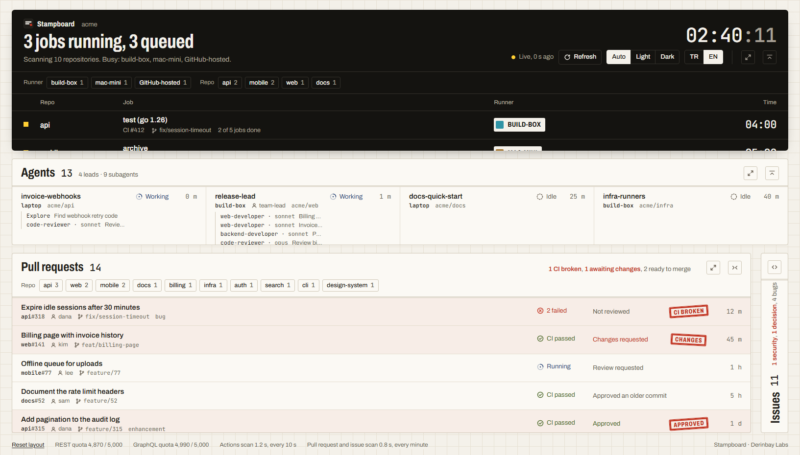
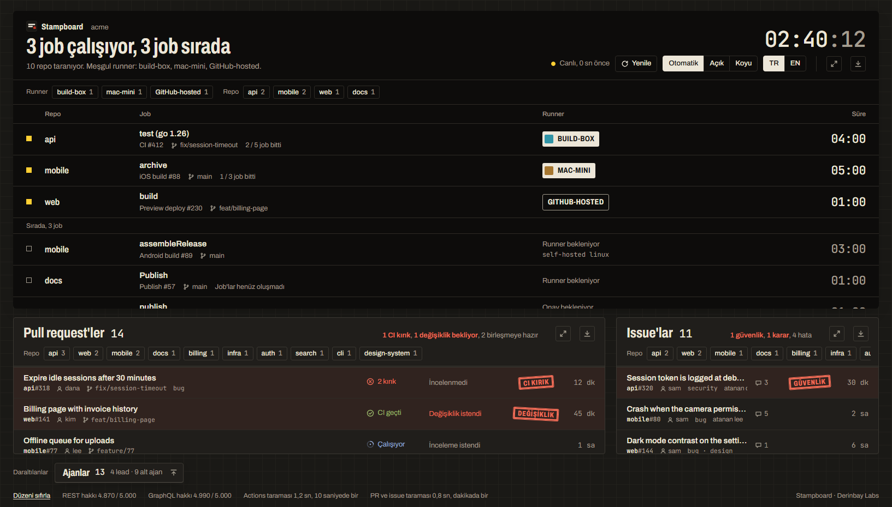
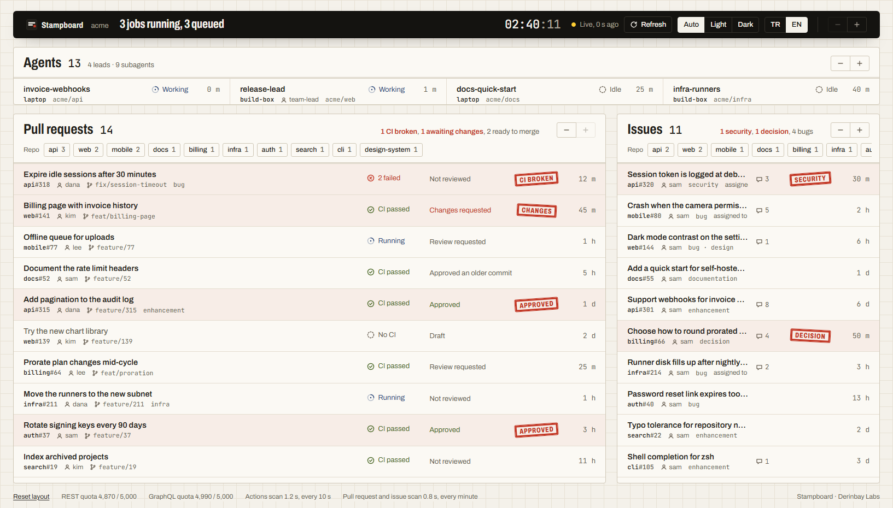

# Section resize: collapse and expand buttons on the four sections

Design for issue #65. **Awaiting the CEO's pick** (constitution §2); nothing is built before it.
Recommended default: **Option 1, Corner pair** (section 4).

Each option has a light mockup in English and a dark mockup in Turkish. Each mockup is one
self-contained HTML file that renders the real page: the demo DOM with the scripts stripped and the
fonts inlined. The file shows the 1920x1080 target. Opened at 1633x930, the same file is the check,
and its committed screenshot is under `section-resize/checks/`.

## 1. User goal

The owner watches Stampboard on one screen all day. Some days the pull requests matter and the
board does not; on other days it is the reverse. He wants to give a section more room, or take it
away, with one press, without the page ever scrolling at 1920x1080. This is the CEO request of
2026-11-26 in #65. Stampboard has no PRD; DESIGN.md is the product reference.

## 2. Entry points

- Small buttons at the top right of each section head: the Actions board, Agents, Pull requests
  and Issues.
- A **Reset layout** text button at the start of the footer. It shows only while the layout
  differs from the default.
- In Option 2, a **shelf** line above the footer holds the folded sections.

## 3. Flow

1. **Default:** there is no stored layout. Every rule in `ledger-filters-and-height.md` §5 applies
   unchanged, so §12 of that spec stays true.
2. **First press of any resize button:** the page measures each open section, as the rendered
   heights and widths, and switches to the *explicit layout* (section 5.2). It then applies the
   press and stores the result.
3. **Collapse:** the section folds. Option 1 and Option 3 keep it in place as a head bar or a
   spine; Option 2 moves it to the shelf. The open sections fill the freed space in proportion to
   their current sizes.
4. **Expand:** the section takes twice its current space. The others shrink in proportion, but
   never below their floors (section 5.3). If 2× does not fit, the section takes all the room the
   floors leave, and from then on its Expand button is disabled and gives the reason.
5. **Undo:**
   - Unfolding a section brings it back at its **default** size, and the others shrink in
     proportion.
   - Option 3's minus halves the section.
   - **Reset layout** clears the stored layout and returns to step 1.
6. **Reload:** the stored layout is re-applied (section 5.6).

## 4. Options

All three options share the space model, the floors, the Agents reconciliation, persistence and
the flowing-layout rule in section 5. They differ in what the CEO sees: the controls, what a folded
section looks like, how the two buttons combine, and how a ledger's "twice" is measured.

| Option | Mockups (1920x1080) | 1633x930 check | Strengths | Weaknesses |
|---|---|---|---|---|
| **1. Corner pair** (recommended) | [light EN](section-resize/mockups/option-1-light.html) · [dark TR](section-resize/mockups/option-1-dark.html) | [light](section-resize/checks/option-1-light-1633x930.png) · [dark](section-resize/checks/option-1-dark-1633x930.png) | Two icon buttons, exactly as asked. A folded section stays where it was, so the eye finds it at once, and its attention counts stay visible. A ledger's Expand doubles its area, so it gains rows. | Shrinking a section without folding it needs Unfold (back to default) or Reset; there is no halve step. The spine's rotated title is slower to read. |
| **2. Shelf** | [light EN](section-resize/mockups/option-2-light.html) · [dark TR](section-resize/mockups/option-2-dark.html) | [light](section-resize/checks/option-2-light-1633x930.png) · [dark](section-resize/checks/option-2-dark-1633x930.png) | All folded sections share one 36px line, so it frees the most room. The tabs read horizontally. A ledger's Expand is a plain width split, the simplest to build. | A folded section leaves its place, which costs spatial memory on a wallboard. A ledger's Expand gains width but no rows. When the board is shelved, its clock and tools must move to the shelf. It adds a new component. |
| **3. Step ladder** | [light EN](section-resize/mockups/option-3-light.html) · [dark TR](section-resize/mockups/option-3-dark.html) | [light](section-resize/checks/option-3-light-1633x930.png) · [dark](section-resize/checks/option-3-dark-1633x930.png) | A symmetric −/+ segment: every step can be undone by the other button, with no Reset needed. The folded look is the same as Option 1's. | "Collapse" becomes a minus that halves before it folds, so folding a large section takes several presses. It reads as zoom, not fold. Disabled halves of the segment are common at the floors. |

**Recommended default: Option 1.** It is the CEO's request taken literally: a collapse and an
expand button per section, with Expand doubling the section and everything else shrinking in
proportion. It keeps every section where the owner expects it, and a folded section still shows
its count and its seal-red attention note. That matters on a wallboard, which is read at a glance
and seldom operated. A ledger's Expand doubles its *area*: a list gains rows only from height, and
a pure width split (Option 2) would double the space while adding nothing readable. Unfold returns
a section to its default size, which covers most undo needs without a third button.

### 4.1 Option 1: Corner pair



Mockup state: Issues folded to a spine, then Pull requests enlarged.

- **Icons and placement:**
  - Two 28px square outline buttons sit at the right end of each head: **Enlarge** (two outward
    diagonal arrows), then **Fold**, which is the rightmost, in the corner.
  - Fold for the board and Agents is a bar with an up chevron (fold up into the head). For a
    ledger it is two chevrons that meet (fold sideways).
  - Unfold mirrors each icon.
  - The ledger pair follows the head note, at `margin-left: 20px`.
  - The board pair ends the tools row, after the EN/TR segment and a 1px `--board-rule` divider.
    The board head already gathers its controls on that row's right edge; a pair above the clock
    would split the controls into two places.
- **What a folded section shows:**
  - **Board:** a 50px bar. It keeps the brand, the headline at 22px (one line, ellipsis), the
    clock at 22px, the live status, Refresh, Theme, EN/TR and the Unfold button. The sub line,
    the filters and the job table go.
  - **Agents:** its head row only (57px), with the count, the `n leads · m subagents` split and
    the unreachable-host note.
  - **A ledger:** a 56px **spine** in its own column. Unfold is at the top. Below it, rotated to
    read bottom-to-top, are the title, the count and the head note, whose seal counts stay
    seal-red. The sibling ledger takes the freed width. With both ledgers folded, the row becomes
    one head-height line with the two heads side by side.
- **How the buttons combine:**

  | State | Enlarge | Fold / Unfold |
  |---|---|---|
  | Default | 2× area, others × k (section 5.1) | Fold; others fill in proportion |
  | Enlarged | 2× again from the current size, until the floors stop it; then disabled with "No more room" | Fold; Unfold later returns the **default** size |
  | Content shown in full | Disabled, "Shows everything already" (the section is at its `max-content` cap) | Fold |
  | Folded | Hidden; Unfold sits in the same corner position | Unfold at default size; others shrink in proportion |
  | Last open section | As above | Disabled, "One section stays open" |
  | Back to default | Reset layout in the footer | |

- **"Twice" for a ledger:** twice its area. The ledger grows taller, by taking height from the
  board and Agents, and wider, by taking width from its sibling, so that every other section's
  area shrinks by the same factor k.
  - With the sibling folded, all of the growth is height. In the mockup, Pull requests goes from
    210px to 419px tall at 1920x1080 and from 184px to 367px at 1633x930, at 1796px and 1509px
    wide.
  - With both ledgers open at 1920x1080, an unclamped Enlarge takes Pull requests from 926x210 to
    about 1317x295, which is 2.0× its area.

### 4.2 Option 2: Shelf



Mockup state: Agents folded to the shelf, then Pull requests enlarged.

- **Icons and placement:** the same corner pair as Option 1, but Fold is an arrow down to a line,
  "fold to the shelf". The board pair sits where it does in Option 1.
- **What a folded section shows:**
  - The section leaves the page. It becomes a **tab** on a 36px shelf line above the footer,
    labelled "Folded" / "Daraltılanlar".
  - A tab is a paper chip, 36px tall, carrying the section title (condensed 18px), the mono count,
    the head note (seal counts stay seal-red) and an arrow-up icon. The whole tab is the Unfold
    button.
  - When the board is shelved, its live status, clock, Refresh, Theme and EN/TR move to the right
    end of the shelf line, so they are never lost.
  - With nothing folded, the shelf line is gone.
- **How the buttons combine:** as in Option 1, except:
  - Unfold is the tab, and the section returns to its place at its default size.
  - Folding moves focus to the new tab, and unfolding moves it to the section's Fold button.
- **"Twice" for a ledger:** twice its **width**. The two ledgers trade width only, and the board and
  Agents are not touched. This is a stated deviation from "the others shrink": only the sibling
  shrinks.
  - The usual result is clamped at the sibling's 480px floor. Pull requests goes from 926px to
    1371px wide (1.48×) at 1920x1080, and from 783px to 1084px (1.38×) at 1633x930.
  - The ledger shows no extra rows.
  - The row's height changes only when the board or Agents folds, enlarges or unfolds.
- In the mockup, shelving Agents freed 246px.
  - At 1920x1080, the board took its share up to its content cap (526 to 581px), and the leftover
    went to the ledger row (210 to 365px).
  - At 1633x930, the board went from 402 to 546px and the row from 184 to 250px.

### 4.3 Option 3: Step ladder



Mockup state: board folded to its bar, then Pull requests enlarged to the floors.

- **Icons and placement:** one joined segment of two 36x28px halves, **−** and **+**, in the same
  corner and board position as Option 1. It is styled like the board's Theme segment, with paper
  colours on the sheets.
- **What a folded section shows:** the same as Option 1: the 50px board bar, the Agents head and
  the ledger spine.
- **How the buttons combine:**

  | State | − | + |
  |---|---|---|
  | Enlarged | Halves the area (the inverse of the last +); others grow in proportion | Doubles again, until the floors stop it; then disabled with "No more room" |
  | Default | Folds | Doubles |
  | Folded | Disabled | Unfolds at default size |
  | Last open section at default | Disabled, "One section stays open" | Doubles |

  A section already shown in full keeps + disabled with "Shows everything already". Reset layout
  returns everything to default.
- **"Twice" for a ledger:** twice its area, as in Option 1. The mockup shows the clamp.
  - With the board folded, the ledger row was 686px (1920) and 536px (1633).
  - One + takes Agents to its 104px floor (it measures 106px) and Issues to its 480px width floor.
  - Pull requests reaches 1371x826 = **1.78×** its area at 1920x1080, and 1084x676 = **1.75×** at
    1633x930. + is then disabled, with "No more room".

## 5. Shared rules

### 5.1 The space model

The space model is used for "in proportion".

- **Space is screen area.** Area is used because the stack (board, Agents, ledger row) shares
  height, while the two ledgers share the row's width.
- **Collapse:**
  - **Board or Agents:** it becomes its head bar. The freed height goes to the open stack items in
    proportion to their current heights. A ledger's area therefore grows by the same factor as the
    board's.
  - **A ledger:** the freed width goes to its sibling, and the board and Agents keep their heights.
    Turning that strip into height would shorten the sibling, so the owner would lose rows by
    folding the list he does not want. This is a stated deviation from the strict reading.
  - In Option 2, the shelved section's slot is replaced by the 36px shelf line.
- **Expand X (Options 1 and 3):**
  1. Let T be the summed area of the open sections. The target is `X' = 2X`. Every other open
     section's area is multiplied by `k = (T − 2X) / (T − X)`.
  2. **X is the board or Agents:** X's height doubles, and the other stack items' heights,
     including the ledger row's, are multiplied by k. The ledger widths are unchanged.
  3. **X is a ledger:** the board's and Agents' heights are multiplied by k. The row takes the rest
     of the height. The sibling's width becomes `k × siblingArea / rowHeight`, and X takes the rest
     of the width.
  4. **Clamp:** pin every section that falls below its floor (section 5.3), and solve again for the
     rest. If 2X still cannot be reached, X takes the largest area the floors allow.
  5. A section never grows past its content (`max-content`). Height it cannot use goes back to the
     others in proportion.
  6. Expand is disabled, staying focusable with `aria-disabled`, when the next press would gain
     less than 5%. The reason is "No more room" when the floors stop it, and "Shows everything
     already" when its content stops it.
- **Expand X (Option 2):** the stack items work as in Options 1 and 3. Ledgers double their width
  only, clamped at the sibling's width floor.
- **Implementation:**
  - The client turns the solved pixel sizes into **fractions**: heights of the stack's free
    height, widths of the row's free width.
  - It applies them as flex weights: `.app.sized > .board, .ag, .ledgers { flex: var(--w) 1 0px;
    max-height: max-content }`, with the floors as `min-height` and `min-width`. The ledger row
    becomes a flex row with `gap: 20px`.
  - Flexbox then shares any leftover in proportion and respects floors and caps on its own.
  - The mockups use exactly these rules (`.app.sized` in their CSS).

### 5.2 Reconciling the Agents-sheet height rules (`ledger-filters-and-height.md` §5)

| Rule today | With no stored layout | In the explicit layout |
|---|---|---|
| The board keeps 3, 4 or 5 job rows (`--rows` cap on `.departures`) | Unchanged | Dropped. The board's height is the owner's choice; its table scrolls inside. |
| Agents yields first (`flex-shrink: 1000`) | Unchanged | Replaced by proportional shrinking above the floors. |
| Agents cap `min(34vh, 360px)` and `max-content` | Unchanged | The 34vh cap is dropped. The `max-content` cap stays, so Agents never grows past its sessions. |
| Agents floor of 104px while it has a session | Unchanged | Kept as its open floor. |
| Ledger floor `calc(var(--lf) + 150px)` (fixed layout; 184px with chip rows) | Unchanged | Kept as the row's open floor. |
| Ledgers stop at their content and hand spare height to Agents | Unchanged | Kept through the `max-content` caps and flex redistribution. |

- **Agents disappears** (no session, no unreachable host): its weight is set aside, and the other
  sections fill its space in proportion.
- **Agents appears** with a stored weight: it takes that weight, and the others shrink in
  proportion.
- **Agents appears with no stored weight**, because the layout was made while it was hidden: it
  enters with the weight of `min(34vh, 360px)` (its default cap), and the others shrink in
  proportion.
- A stored folded state for Agents is kept, so a new session shows as the head bar, with its
  count, until unfolded.

### 5.3 Floors

| Section | Open floor | Folded size | Cap |
|---|---|---|---|
| Board | 200px tall (head plus the empty line, today's `min-height`) | 50px bar (Options 1 and 3); a shelf tab (Option 2) | Content (`max-content`; 581px with the demo's 6 jobs) |
| Agents | 104px tall while it has a session; content-sized otherwise | 57px head | Content |
| Ledger row | `calc(var(--lf, 0px) + 150px)` tall | 57px, when both ledgers are folded | The taller ledger's content |
| Pull requests | 560px wide (fixed columns 468px plus a 92px title) | 56px spine | — |
| Issues | 480px wide (fixed columns 258px plus title and head) | 56px spine | — |

At 1281px wide, the narrowest fixed layout, the row is 1213px. The two width floors (1040px) fit,
and the default 50/50 split (606px each) is above both. At 761px tall, the stack has about 664px,
and the open floors (200 + 104 + 184 = 488px) fit.

### 5.4 Flowing layout (below 1280px wide or 760px tall)

- The page scrolls and the ledgers stack, so the ledgers share height there, not width.
- **Collapse still works.** Every folded section is a head bar, and a ledger is a head bar, not a
  spine. In Option 2, the shelf stays above the footer.
- **Enlarge is hidden**, and in Option 3 the + is hidden unless it is the unfold control. A flowing
  page has no fixed total to share, and each section is already content-sized under its 75vh cap.
- Stored weights are kept, unchanged, for when the window returns to the fixed layout.

### 5.5 Keyboard, focus and ARIA

- **Controls:** every control is a native `<button type="button">`, so Enter and Space work. There
  are no new shortcuts.
- **Fold toggle (Options 1 and 2), and + while folded in Option 3:**
  - It has `aria-expanded` (`true` while the body shows) and `aria-controls` set to the body's id:
    `board`, `agList`, `prList`, `isList`, or `agents` for a shelf tab.
  - Its accessible name is constant and names the body: "Pull request list" / "Pull request
    listesi". The visible tooltip (`title`) reads Fold / Unfold.
  - This keeps the CEO's "Expand" (2×) apart from `aria-expanded` (shown or not).
- **Enlarge and −:** plain buttons named for the action, for example "Enlarge Pull requests" /
  "Pull request'leri büyüt". When the action is blocked, they carry `aria-disabled="true"` plus an
  `aria-description` giving the reason, and they stay focusable.
- **A folded body** gets the `hidden` attribute, so it leaves the tab order and the accessibility
  tree; clipping it is not enough. A folded board hides `#filters` and `#board`.
- **Announcements:** a polite live region announces the result of Enlarge, − and Reset ("Pull
  requests enlarged", "Layout reset"). A fold is announced through `aria-expanded`.
- **Focus order:** board tools (Refresh, Theme, EN/TR), then the board pair, then board chips and
  board rows. After that: the Agents head pair and the Agents body, then the PR head pair, PR chips
  and PR item links, then the Issues head pair, Issues chips and Issues item links. In Option 2 the
  shelf tabs follow, then Reset layout.
  - Focus stays on the pressed button. In Option 2 it moves to the tab after a fold, and to the
    Fold button after an unfold.
- **Hit area:** each 28px button has a transparent `::after` at `inset: -8px`, so the hit area is
  44x44px. A 16px visible gap keeps neighbouring hit areas from overlapping. The Option 3 halves
  are 36x28px with the same vertical extension, so 36–44 x 44px.
- **Motion:** none. Resizing is instant. DESIGN.md's single motion, the seal stamp, stays the only
  motion, and nothing new depends on `prefers-reduced-motion`.

### 5.6 Persistence

- The layout survives a reload. It is stored in `localStorage` under `stampboard-layout`, beside
  `stampboard-theme` and `stampboard-lang`, through the same `store` wrapper. A failed write only
  loses the layout.
- The stored value is JSON:

  ```json
  {"v": 1,
   "stack": {"board": 0.39, "agents": 0.18, "ledgers": 0.43},
   "row": {"pr": 1, "is": 0},
   "base": {"board": 0.54, "agents": 0.25, "ledgers": 0.21, "pr": 0.5, "is": 0.5},
   "folded": ["is"]}
  ```

  The values are fractions, so a different window size re-applies the same proportions, and the
  floors are checked again. `base` is the default measured at the first press; Unfold returns to
  it.
- Reset layout removes the key and drops the `.sized` class.

## 6. Screen states

| Section | Empty | Loading | Error | Partial data | Offline |
|---|---|---|---|---|---|
| Board | No jobs: an open board is 200px; Expand reads "Shows everything already". A folded bar is unchanged. | Before the first scan, the resize buttons are present, but the layout stays default until a press. | A board alert renders inside `.departures`. While the board is folded, the bar's headline is replaced by the alert line (seal-strong label plus message, one line, ellipsis), and the live status already shows Disconnected in seal. An alert never hides. | Two-line filter bar: the board's content cap grows by one line. | Last data. The layout is unchanged; the live status is seal-red. |
| Agents | Hidden: its weight is set aside (section 5.2). Unreachable hosts only: content-sized, no floor. | Hidden until data. | Unreachable host: the seal note stays in the head, so it stays visible while folded. | A session without subagents: unchanged. | Last data. |
| Ledgers | No items: an open ledger keeps its floor and shows `.l-empty`. A folded ledger shows count 0. | A folded ledger shows its head as it loads. | Kept scan: as today. A folded ledger's note shows the error text in seal. | One ledger with chips: the row floor includes `--lf`. | Last data. |
| Shelf (Option 2) | Hidden with nothing folded. | n/a | A tab carries the section's seal note. | n/a | n/a |

## 7. Components and tokens

- **Reused:** the `.btn` and `.seg` look (the board pair and the Option 3 segment), the `.chip`
  paper look (Option 2 tabs), the `.l-head`, `.l-count` and `.l-note` markup, the `.sr` helper,
  the `store` wrapper, and the tokens `--ink`, `--muted`, `--rule`, `--sheet`, `--sheet-hover`,
  `--board-*`, `--seal` and `--focus`. There is no new token or colour.
- **New, and why none fits:**
  - `.rz`, the head button pair. No existing control is an icon-only head action.
  - `.spine` (Options 1 and 3). No component reads in a 56px column.
  - The folded board bar (all options; the Option 2 shelf line takes its tools).
  - `.shelf` and `.tab` (Option 2).
  - `.app.sized`, the explicit layout.
- The icons are authored 16-unit SVGs drawn with the same 1.6 stroke as the Refresh icon. They are
  not glyphs.

### 7.1 Measured result (headless Chrome, CSS viewport checked with `innerWidth` and `innerHeight`)

All 12 renders (3 options × light and dark × 2 sizes) have `scrollHeight` equal to `innerHeight`
and `scrollWidth` equal to `innerWidth`, so nothing overflows the viewport.

| Render | Board | Agents | Ledger row | PR width | Issues width | The expanded section |
|---|---|---|---|---|---|---|
| Default 1920x1080 (master, demo data) | 526 | 246 | 210 | 926 | 926 | — |
| Default 1633x930 | 402 | 246 | 184 | 783 | 782 | — |
| Option 1, 1920x1080 | 382 | 181 | 419 | 1796 | 56 (spine) | PR height 210 → 419 (2.0×) |
| Option 1, 1633x930 | 288 | 178 | 367 | 1509 | 56 (spine) | PR height 184 → 367 (2.0×) |
| Option 2, 1920x1080 | 581 (content cap) | shelf (36) | 365 | 1371 | 481 (floor) | PR width 926 → 1371 (1.48×, clamped) |
| Option 2, 1633x930 | 546 | shelf (36) | 250 | 1084 | 481 (floor) | PR width 783 → 1084 (1.38×, clamped) |
| Option 3, 1920x1080 | 50 (bar) | 106 (floor) | 826 | 1371 | 481 (floor) | PR area 1.78× (clamped) |
| Option 3, 1633x930 | 50 (bar) | 106 (floor) | 676 | 1084 | 481 (floor) | PR area 1.75× (clamped) |

`impeccable detect` on the six mockups reports:

- tiny-text: the incumbent 11.5px mono meta lines;
- the grid-paper background and the cream palette: the accepted DESIGN.md world;
- cramped-padding: the ledgers' flush list rows, which are incumbent.

There is no finding on the new controls.

## 8. Copy

Every string goes into `STRINGS`. Turkish keeps "Pull request" and "Issue" as the product already
does, and inflects them with an apostrophe. The Turkish action labels are per section, not a
template, because the accusative suffix differs.

| Key | TR | EN | Notes |
|---|---|---|---|
| `secBoard` | `Actions panosu` | `Actions board` | Section name |
| `enlargeBoard` / `enlargeAgents` / `enlargePr` / `enlargeIs` | `Actions panosunu büyüt` / `Ajanları büyüt` / `Pull request'leri büyüt` / `Issue'ları büyüt` | `Enlarge the Actions board` / `Enlarge Agents` / `Enlarge Pull requests` / `Enlarge Issues` | Expand and + names |
| `shrinkBoard` / `shrinkAgents` / `shrinkPr` / `shrinkIs` | `Actions panosunu küçült` / `Ajanları küçült` / `Pull request'leri küçült` / `Issue'ları küçült` | `Shrink the Actions board` / `Shrink Agents` / `Shrink Pull requests` / `Shrink Issues` | Option 3 − only |
| `bodyBoard` / `bodyAgents` / `bodyPr` / `bodyIs` | `Actions işleri` / `Ajan oturumları` / `Pull request listesi` / `Issue listesi` | `Actions jobs` / `Agent sessions` / `Pull request list` / `Issue list` | Constant names of the `aria-expanded` toggles |
| `tipFold` / `tipUnfold` | `Daralt` / `Aç` | `Fold` / `Unfold` | Tooltip |
| `tipShelf` | `Rafa kaldır` | `Fold to the shelf` | Option 2 tooltip |
| `tipEnlarge` / `tipShrink` | `Büyüt: iki kat yer` / `Küçült: yarı yer` | `Enlarge: twice the room` / `Shrink: half the room` | Tooltip |
| `noRoom` | `Daha fazla yer yok` | `No more room` | `aria-description` and tooltip of a disabled Enlarge |
| `showsAll` | `Tümü zaten görünüyor` | `Shows everything already` | The same, at the content cap |
| `lastOpen` | `Bir bölüm açık kalır` | `One section stays open` | Disabled Fold |
| `resetLayout` | `Düzeni sıfırla` | `Reset layout` | Footer button |
| `shelf` / `shelfLabel` | `Daraltılanlar` / `Daraltılan bölümler` | `Folded` / `Folded sections` | Option 2 visible label and group name |
| `enlarged(name)` / `shrunk(name)` / `layoutReset` | `${name} büyütüldü` / `${name} küçültüldü` / `Düzen sıfırlandı` | `${name} enlarged` / `${name} shrunk` / `Layout reset` | Live region; `name` is the nominative section name |

## 9. Accessibility acceptance criteria

- **Contrast** (computed from the tokens):

  | Pair | Light | Dark |
  |---|---|---|
  | Icon on a sheet head (`--muted` on `--sheet`) | 6.0:1 | 6.2:1 |
  | Icon on hover (`--ink` on `--sheet-hover`) | ≥ 15:1 | ≥ 12:1 |
  | Board icon (`--board-muted` on `--board`) | 7.3:1 | 7.3:1 |
  | Board icon on hover (`--board-ink` on `--board-2`) | 14.9:1 | 14.4:1 |
  | Reset layout (`--ink` on `--paper`) | 14.4:1 | 14.1:1 |
  | Shelf label (`--muted` on `--paper`) | 5.6:1 | 6.5:1 |
  | Seal note on a spine or tab (`--seal` on `--sheet`) | 5.2:1 | 5.4:1 |
  | Focus ring, sheet (`--focus`) and board (`--lamp`) | 8.4:1 and 12.6:1 | 7.0:1 and 13.2:1 |

  - The 1px button border (`--rule` 1.6:1 and 1.4:1, `--board-rule` 1.4:1) is decoration. The
    6:1 icon identifies the control (WCAG 1.4.11).
  - A disabled control at 40% opacity is exempt, and its state is exposed by `aria-disabled` and
    the reason text.
- **Target size:** each button's hit area is at least 44x44px (Option 3 halves: 36–44 x 44px,
  above WCAG 2.5.8; see section 11). Shelf tabs are 44px tall with their `::after`. The 50px
  board bar keeps the 29px Refresh, Theme and EN/TR buttons as they are today.
- **Not colour alone:** folded and open differ in shape (bar or spine, against a full section)
  and in `aria-expanded`. Attention in a folded section keeps its words ("1 CI broken"), not only
  the seal colour.
- **Screen reader checks**, for the developer and QA:
  1. Tabbing to the PR Fold button reads "Pull request list, toggle button, expanded, Fold".
     After Enter it reads "collapsed", and the list's links are gone from the virtual cursor.
  2. Enlarge on Agents when it shows all sessions reads "Enlarge Agents, button, dimmed, Shows
     everything already". It stays in the tab order.
  3. Enlarge on Pull requests announces "Pull requests enlarged" once, politely.
  4. In Turkish (`?lang=tr`), the same controls read the TR names from section 8.
- **Focus order:** as in section 5.5. A folded body never takes a tab stop. Focus never lands on
  `<body>` after a fold, because it stays on the button or, in Option 2, moves to the tab.
- **Layout checks**, for the developer and QA:
  - At 1920x1080 and at 1633x930, light and dark, after any sequence of presses:
    `scrollHeight === innerHeight` and `scrollWidth === innerWidth`.
  - Each open section is at least its floor (section 5.3).
  - Reset returns the measurements of `ledger-filters-and-height.md` §12 exactly.
- **Motion:** none added.

## 10. DESIGN.md lines to update (after the pick; not edited here)

- **Line 9 (Agents sheet):** after "…(+34px with chip rows).", add "These rules hold until the
  owner resizes a section; the explicit layout (`docs/design/section-resize.md`) then replaces
  the row guarantee, the 34vh cap and the yield order with proportional shares above the same
  floors."
- **New line after Ledgers (Option 1 wording):** "Resize: every section head ends in a 28px
  Enlarge / Fold pair (44px hit). Fold leaves the head (a 50px bar for the board, a 56px spine for
  a ledger) and keeps its counts and seal notes. Enlarge doubles the section's area while the
  others shrink in proportion above their floors. The layout is stored in `stampboard-layout`.
  Reset layout sits in the footer. Resizing is instant."
- **Line 14 (Layout):** add "Below that, Fold still works and Enlarge is hidden."

## 11. Platform notes

Web only, on desktop evergreen browsers. Flex `max-height: max-content` and `:has()` are already
relied on.

## 12. Open questions

- **Option 3's halves:** they are 36px wide, below the house 44px bar but above WCAG 2.5.8's
  24px. Widening them to 44px makes the segment 88px. Decides: ux-designer, if the CEO picks
  Option 3.
- **Reset layout hit area:** the footer button's hit area is 37px tall, because the footer sits
  12px above the viewport edge. This is below the house 44px bar and above WCAG's 24px. Decides:
  ux-designer at implementation review.
- **Spine text:** a very long Turkish note can be clipped by ellipsis on a short spine at
  760–800px tall. Its count and the first seal count always show. Decides: ux-designer after a
  week of use.
- **Motion:** a 150ms flex transition, under `prefers-reduced-motion: no-preference`, would make
  the jump easier to follow, but it would add a second motion to DESIGN.md. Decides: CEO, only if
  asked; the default is none.
