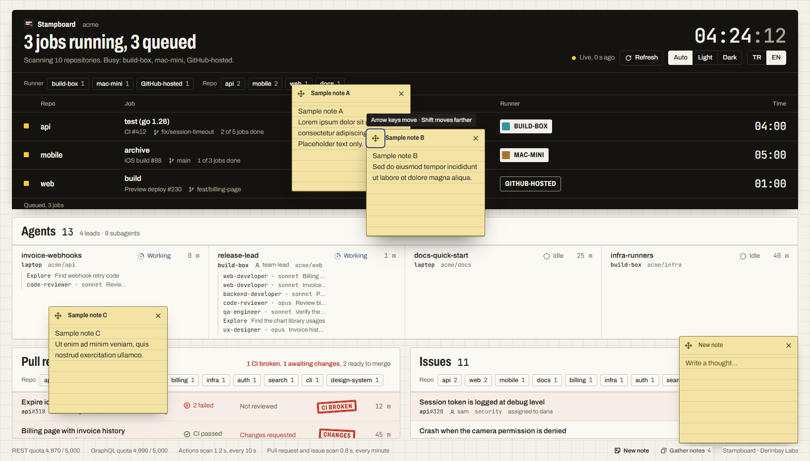
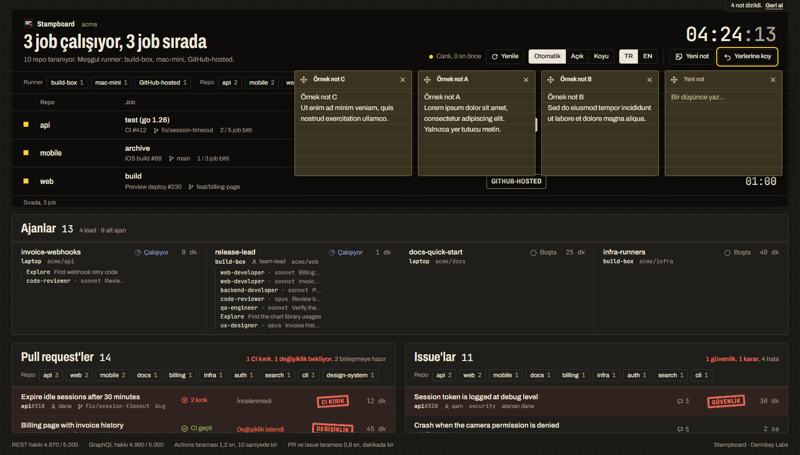
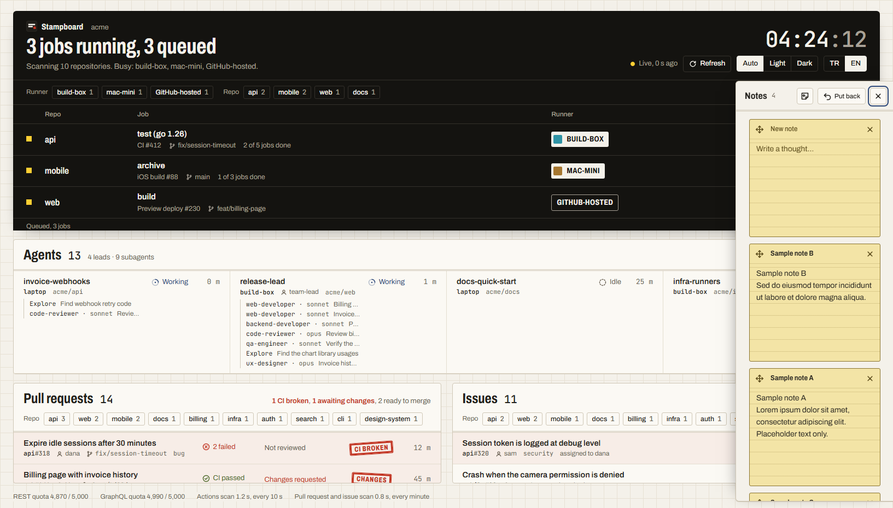

# Sticky notes: private notes on top of the page, gathered with one press

Design for issue #66. **Accepted: Option 1, Corner pile** (section 4.1), chosen by the CEO on
2026-11-27 in #74. Options 2 and 3 are kept for the record; implementation is #68.

Each option has a light mockup in English and a dark mockup in Turkish. Each mockup is one
self-contained HTML file that renders the real page: the demo DOM with the scripts stripped and the
fonts inlined. The file shows the 1920x1080 target with the notes **spread out**. Add `#gathered`
to the address, or press the option's gather control in the mockup, to see the **gathered** state.
Opened at 1633x930, the same file is the check. Both states, in both themes, have a committed
screenshot under `sticky-notes/checks/`. All note text in the mockups is invented placeholder text
("Sample note A", Lorem ipsum).

## 0. Realism pass (#81): the current behaviour

Issue #81 gave the notes of #68 the look and handling of real Post-its. **This section is current
and wins over sections 3 to 9 and 12 where they differ**; those sections describe the first
implementation (#68) and the options debate, and the lines they carry that #81 replaced are marked
"(#81)" below. Section 5.1 (privacy), the 50-note limit, corner anchoring, clamping, undo, the
cross-tab merge, TR/EN and light/dark are unchanged.

**Paper.** Plain paper with no ruled lines. The top 20% is flat with no shadow; the bottom edge
and the two bottom corners lift, with a soft curved shadow (a `box-shadow` plus two tipped
pseudo-element shadows). A very faint SVG `feTurbulence` grain (10% opacity, multiply) lies on the
paper. Text is drawn with `text-rendering: geometricPrecision`, so it stays sharp on a tilted card.

**Tilt and lift.** A new note gets a random tilt of -4 to +4 degrees. While held, a note is
`scale(1.03)` with a deeper shadow; on drop it settles at a new random tilt within 1.5 degrees of
the old one, never beyond 4 degrees. A clicked or dragged note comes to the front.

**Writing.** One free text area, with no separate title box. After the first line is written and
Enter pressed, the first line gets a light emphasis (a half-pixel text stroke, so widths do not
change). There is no scrollbar: the font steps down by 1px (to 8px) until the text fits, and input
that would not fit at 8px is refused, with a polite "The note is full." announcement. A saved note
that already overflows is shown as it is. `- ` or `* ` at the start of a line becomes a plain
bullet; Enter in a bullet starts the next one, Enter on an empty bullet ends the list. Clicking a
bullet line (or Ctrl+Enter in it) strikes it through like pencil; again clears it.

**Struck bullets (storage representation).** The state lives in the text itself, so it follows
edits, undo and the cross-tab merge: a bullet line starts with `• `, an open one; a struck
line starts with `✓ `. `- ` and `* ` are accepted on load and shown as bullets.

**Right-click menu.** Right-click on a note, Shift+F10 or the context-menu key in it, or the
**Note options** button in its header (which replaces the old Delete button) opens a `role=menu`
at the pointer or the note, kept 8px inside the screen. From the top:

1. Round swatches, `menuitemradio` with names: Classic Yellow, Pastel Pink, Mint Green, Light
   Blue, Orange. Dark mode mixes each colour 24% into the dark base.
2. Fonts, `menuitemradio`, each shown in its own face: Caveat, Kalam, Patrick Hand, Architects
   Daughter and Archivo (plain sans). Bundled under `fonts/` as Latin plus Turkish woff2, with
   their OFL licences; no CDN.
3. **A+ / A-** step the size through 10, 12, 14, 16, 18, 20, 24, 28, 32 and stay open.
4. **Random tilt** and **Reset angle (0 degrees)** stay open.
5. **Pin to front** (`menuitemcheckbox`): the note stays above unpinned ones and shows a dog-ear
   in the bottom-right corner.
6. **Delete note**, then the usual Undo in the status line.

Arrow keys, Home and End move through the menu; Escape or Tab close it. Choosing a colour, a font,
Pin or Delete closes it; focus returns to the note (or to the Note options button that opened it).

**Gather.** Each note moves to the corner slot (section 4.1) with an 8 to 18px random X and Y
offset and a -8 to +8 degree tilt, animated for about half a second; a messy pile, not a tidy
staircase. A click or drag on a note in the pile pulls it out and to the front. Positions, angles
and the stacking order are saved, and Undo restores the old positions and angles.

**Pass-through layer.** The notes layer takes no pointer events; only a note's own parts do (and
the paper and the dog-ear never do), so clicks and text selection reach the board between notes.

**Motion.** Lift, settle and Gather are animated only when the user has not asked to reduce
motion (`prefers-reduced-motion: no-preference`); otherwise they are instant. The stamp stays the
board's only motion.

**Storage v2.** Key `stampboard-notes`, `{v:2,notes:[{id,text,x,y,z,angle,font,size,color,pinned}]}`.
`x` and `y` stay corner-anchored offsets. `angle` is degrees (-8..8, one decimal), `font` one of
`caveat, kalam, patrick, architects, sans`, `size` one of the sizes above, `color` one of
`yellow, pink, mint, blue, orange`, `pinned` a boolean. A v1 record `{id,text,x,y,z}` loads with
`angle 0, font sans, size 14, color yellow, pinned false` (its old look) and becomes v2 on the next
save; opening alone does not rewrite the store. Any other `v` is treated as unreadable, and
unreadable records are kept untouched. New notes start as Caveat 16px, yellow, unpinned.

## 1. User goal

The owner keeps Stampboard open on one screen all day. While he watches it, he has thoughts and
business ideas he wants to write down at once, right where he is looking, without opening another
app. He wants to drop a note anywhere, even over the board or a ledger, and later clear the page
with one press that gathers every note into one place. This is the CEO request of 2026-11-26 in
#66. Stampboard has no PRD; DESIGN.md is the product reference.

**Privacy constraint (fixed, not an option).** This repository is public, and note text is the
CEO's private business ideas. Note text is never committed, never sent to GitHub or any other
host, and never written to a log. It is stored only on this machine (section 5.1).

## 2. Entry points

- A **New note** control. Its place is what the options differ on: the footer (Option 1), the
  board's tools row (Option 2), or a tab on the right edge (Option 3).
- A **gather** control beside it: **Gather notes** (Option 1), **Line up notes** (Option 2), or
  **Notes** (Option 3). It shows the note count and is one press from the resting page in every
  option.
- The notes themselves: each note's header is the drag handle. Each note has a Move button and a
  Note options button (#81); Delete is in the note's menu.

## 3. Flow

1. **Create:** press New note. An empty note opens at the option's creation spot (section 4),
   above everything else, and the caret is in its text.
2. **Write:** type. The text is saved locally while typing (section 5.2). After the first line and Enter, the first line
   reads as a title (#81); the header no longer shows it.
3. **Leave empty:** if a new note is still empty when it loses focus, or when Escape is pressed in
   it, it is discarded without a message.
4. **Move:** drag the header with a mouse, or press Move and then click where the note should go,
   or focus Move and use the arrow keys (section 5.4).
5. **Delete:** choose Delete note in the note's menu (#81). The note goes at once, and the status line offers **Undo** for
   10 seconds (section 5.3).
6. **Gather:** press the gather control. Every note moves to the option's gathering place, animated
   unless motion is reduced (section 4, #81). The status line says how many notes were gathered and offers **Undo** for
   10 seconds.
7. **Reload or a new day:** the notes come back where they were, from local storage.

## 4. Options

All three options share the note itself, editing, deleting, moving, the z-order, the off-screen
rule, privacy and storage (section 5). They differ in where a note is created, where the
controls live and what "gather" does.

| Option | Mockups (1920x1080) | 1633x930 checks | Strengths | Weaknesses |
|---|---|---|---|---|
| **1. Corner pile** (accepted) | [light EN](sticky-notes/mockups/option-1-light.html) · [dark TR](sticky-notes/mockups/option-1-dark.html) | light: [spread](sticky-notes/checks/option-1-light-scattered-1633x930.png) · [gathered](sticky-notes/checks/option-1-light-gathered-1633x930.png); dark: [spread](sticky-notes/checks/option-1-dark-scattered-1633x930.png) · [gathered](sticky-notes/checks/option-1-dark-gathered-1633x930.png) | One press gathers everything into one predictable 240px column in the bottom-right corner. Every note stays on the page and its title stays readable. The controls live in the footer, which no section-resize option folds or moves. Adds no component beyond the note. | The pile covers the right end of the Issues ledger: ages and seals of the bottom rows. Only the front note's text is readable in the pile; the others show their title line. The footer buttons are small text (17px visual, 44px hit area). |
| **2. Board line-up** | [light EN](sticky-notes/mockups/option-2-light.html) · [dark TR](sticky-notes/mockups/option-2-dark.html) | light: [spread](sticky-notes/checks/option-2-light-scattered-1633x930.png) · [lined up](sticky-notes/checks/option-2-light-gathered-1633x930.png); dark: [spread](sticky-notes/checks/option-2-dark-scattered-1633x930.png) · [lined up](sticky-notes/checks/option-2-dark-gathered-1633x930.png) | Every gathered note is fully readable, side by side. Gathering can be undone at any time with **Put back**, which returns every note to where it was. The controls sit with the board's other tools. | The row covers the board's runner and time columns, the live data the wallboard exists for. The tools row grows by about 270px, so the headline loses that width. If #72 picks the Shelf, the two buttons must move to the shelf with the board's tools. |
| **3. Edge drawer** | [light EN](sticky-notes/mockups/option-3-light.html) · [dark TR](sticky-notes/mockups/option-3-dark.html) | light: [spread](sticky-notes/checks/option-3-light-scattered-1633x930.png) · [drawer](sticky-notes/checks/option-3-light-gathered-1633x930.png); dark: [spread](sticky-notes/checks/option-3-dark-scattered-1633x930.png) · [drawer](sticky-notes/checks/option-3-dark-gathered-1633x930.png) | Gathering clears the page completely once the drawer is closed. The drawer lists every note at full size and scrolls, so it holds any number. It does not depend on the section layout; once #72 ships, the fixed tab can sit over a right-edge spine or a head's corner button, so its vertical place may need a rule. | Gathered notes are out of sight when the drawer is closed, which works against "write thoughts where I look". The open drawer covers a 288px strip on the right. The tab overlaps 20px of the sheets' right edge. It adds two components (tab and drawer) and drawer focus handling. |

**Recommended default, and the CEO's pick (#74): Option 1.** It is the request taken literally: notes live on the page, and
one press puts them all in one place where they stay visible. The pile costs the least space of
the three gathered states (one 240px column), and it sits in the one corner the eye reaches last
on a wallboard read top-left to bottom-right. The footer is the only place that no section-resize
option (#72) folds, shelves or moves, so the controls are stable whatever the CEO picks there.
Option 2 covers the board's live data, and Option 3 hides the notes it gathers.

### 4.1 Option 1: Corner pile

Mockup state: three notes spread over the board and the Pull requests ledger, note B on top of note
A with keyboard focus on its Move button, and a new empty note at the pile spot. In `#gathered`, the
four notes are piled and focus is on Gather notes.

- **Controls:** two text buttons at the right end of the footer, before the credit:
  **New note** (note-with-plus icon) and **Gather notes** (two stacked cards) followed by the mono
  count. Ink on paper at 12px/600, 17px tall like the footer line, with a 44px hit area that
  reaches 15px up and 12px down to the viewport edge. The footer keeps its 17px height (measured).
- **Where a new note opens:** at the front of the pile spot: 24px from the right edge, its bottom
  44px above the viewport bottom, clear of the footer buttons' hit area. A new note on top of the pile is
  simply the pile's newest card; the owner drags it out if he wants it elsewhere.
- **Gather (replaced by #81, section 0):** every note goes to the same spot in the bottom-right corner:
  `right: 24px`, the bottom 44px above the viewport bottom. Each note gets its own random 8 to 18px
  X and Y offset (either direction) and a -8 to +8 degree tilt, so the pile is messy, not stepped. The
  front note is the one touched last; the pile keeps the notes' z-order.
- **Pile size:** one note plus the offsets, about 258x234px, for any number of notes (the old 36px
  step, extra columns and the 148px top limit no longer apply). Back notes are partly covered; a
  back note is pulled out by pressing any part of it that shows.
- **With #72's Shelf:** if the Shelf wins, the pile's bottom offset adds the shelf line's height,
  so the pile sits above the shelf, not on it.
- **What the pile covers:** at 1920x1080, a block of about 258x234px over the right end of the
  Issues ledger (its age and seal columns) and the bottom-right corner of the Agents sheet.
- **After gathering:** the pile positions become the notes' stored positions. Undo, offered for
  10 seconds in the footer status, returns every note to where it was.

### 4.2 Option 2: Board line-up

Mockup state: the same spread notes, with the new note in the first line-up slot. In `#gathered`
the four notes stand in a row under the board head, and focus is on Put back.

- **Controls:** after the EN/TR segment and a 1px `--board-rule` divider, two board `.btn`s:
  **New note** and **Line up notes** with the mono count. After a line-up, Line up notes is
  replaced by **Put back** (back-arrow icon) in the same place. The tools row grows from 432px to
  700px (EN) and from 467px to 706px (TR). The headline keeps one line (41px tall) at 1633px wide (measured:
  807px wide in TR).
- **Where a new note opens:** in the first free line-up slot, which is the rightmost slot no note
  overlaps.
- **Gather (line up):** the notes stand side by side under the board head, top edge at 144px, 12px
  apart, filled from the right edge (`right: 36px`) leftwards, the note touched last on the right.
  A row holds 7 notes at 1920px and 6 at 1633px. Further rows go 228px lower, while they fit above
  the footer: 4 rows at 1920x1080 and 3 at 1633x930, so 28 and 18 notes. Notes beyond that stack on the last slot,
  24px apart diagonally.
- **What the line-up covers:** at 1920x1080 with 4 notes, a 996x216 block over the board's runner
  and time columns and part of the job names.
- **Put back** returns every note to its position before the line-up, which is kept until a note
  is moved. Moving any note ends the line-up: Put back becomes Line up notes again.
- **With #72:** with the board folded to a bar, the tools row stays, and so do the buttons. If the
  Shelf wins, the board's tools move to the shelf line, and these two buttons go with them.

### 4.3 Option 3: Edge drawer

Mockup state: the same spread notes, with the new note just left of the tab. In `#gathered` the
drawer is open with the four notes in it, and focus is on its close button.

- **Controls:** a 44px-wide tab on the right viewport edge, vertically centred, in `--sheet` with a
  `--rule` border: **New note** (44x44) on top, then **Notes** (drawer icon, the word set vertically
  like the section-resize spine, and the mono count). The tab overlaps the right 20px of whatever
  sheet is behind it.
- **Where a new note opens:** just left of the tab (`right: 56px`), vertically centred.
- **Gather:** pressing Notes moves every note into the drawer and opens it. The drawer is a 288px
  panel on the right edge, from 148px (below the board's tools row) to 12px above the bottom. It has
  a head (Notes, count, New note, **Put back**, Close) with the ledgers' 3px double rule, then the
  notes at full size, stacked 12px apart, newest first, in a list that scrolls.
- **Closing the drawer** hides the gathered notes; the tab's count still shows them.
- **Taking a note out:** drag it by its header out of the drawer, or press Move and click a spot on
  the page. **Put back** returns every note to its last place on the page.
- **What the open drawer covers:** a 288px strip on the right: the board's time column, the right
  end of the Agents sheet and the Issues ledger's age and seal columns.

## 5. Shared rules

### 5.1 Privacy and storage (fixed)

- Note text stays on this machine. The architect or developer picks one of two stores in the
  implementation issue:
  - browser storage under the key `stampboard-notes`, or
  - a local file `notes.json` under the server's state directory (`stateDir()` in `config.mjs`:
    `%LOCALAPPDATA%\stampboard` on Windows). It is outside the repository, and a `.gitignore` entry
    is added as well if any path inside the repository is ever used.
- If the file is chosen, the endpoint answers on the server's existing `127.0.0.1` listener and
  host check only.
- Note text never appears in:
  - a request to GitHub, or to any host other than the local server;
  - `server.log` or the browser console. A log line may carry counts only. Example:
    `notes saved: 4 notes, 1.2 KB`;
  - the page title, a URL, a notification, or an error report;
  - the demo. With `--demo`, the page uses an in-memory, empty store and never reads or writes the
    real one. So README screenshots and mockup dumps cannot capture real notes.
- No note text in tests, fixtures, issues or PRs: they use invented text such as "Sample note A".

### 5.2 The note

- **Size:** 240x216px, which is 10x9 cells of the 24px paper grid. It is fixed; the request does not
  ask for resizing (section 12).
- **Surface (#81):** the `--nc-*` colours (section 0), plain paper with a lifted bottom and a faint
  grain; no border, no ruled lines.
- **Header (28px, #81):** the **Move** button (four-way arrow) and, at the right, **Note options**
  (three dots). There is no title and no Delete button in it; the accessible name of the note
  (`Note: <first line>`) still comes from the first line. The header is the drag handle
  (`cursor: grab`).
- **Body (#81):** one text area in the note's font (Caveat 16px for a new note), with the first
  line emphasised after Enter. The placeholder is "Write a thought…". It never scrolls: the font
  steps down and input is limited (section 0). Up to 4,000 characters; at 3,800 a mono counter
  appears at the bottom right.
- **Saving:** 400ms after the last keystroke, and on blur. There is no Save button.
- **Limit:** 50 notes. At 50, New note is disabled with "50 notes is the limit. Delete one to add
  another."

### 5.3 Delete and undo

- **Delete note** in the note's menu (#81; it was an × button) deletes the note at once, without a dialog. The status line next to the controls says
  "Note deleted." with an **Undo** button for 10 seconds. Undo restores the text, position and
  z-order. Focus then moves to the next note's Move button, or to New note if none is left.
- An empty note is discarded on blur without a message.
- Gather uses the same status pattern ("4 notes gathered." · Undo).

### 5.4 Moving: mouse, single click and keyboard

- **Drag:** press on the header (or on Move) and move more than 4px. The note lifts (stronger shadow,
  2px up) and follows the pointer. On release it snaps to the nearest 24px paper-grid cell and is
  saved.
- **Click to place** (no dragging needed, WCAG 2.5.7): a click on Move without movement picks the
  note up. Move shows as pressed, the pointer becomes a crosshair, and the status line says
  "Click where the note goes. Escape cancels." The next click on the page places the note's
  top-left corner there, snapped and clamped. Escape, or a second click on Move, cancels.
- **Keyboard:** with focus on Move, the arrow keys move the note by one grid cell (24px) and
  Shift+arrows by four (96px). Each step is saved. A tooltip under focus says "Arrow keys move ·
  Shift moves farther". After a pause of 1 second, a polite live region says "Note placed."
  once, not on every step. The note cannot leave the viewport (section 5.6).
- **Bring to front:** any pointer press or focus inside a note puts it on top of the others.

### 5.5 Z-order

- The notes layer is `position: fixed; inset: 0; z-index: 50`, above every section, the
  section-resize controls, alerts and seals. The layer itself lets clicks through (only the notes
  take pointer events), so the page under the empty parts still works.
- Within the layer, the note touched last is on top; the order is stored.
- The notes controls (footer buttons, board buttons or edge tab, and the drawer) are at
  `z-index: 60`, so a note can never cover the control that gathers it.
- **Focus reveal** (WCAG 2.4.11): when keyboard focus lands on a page control that notes cover
  completely, the covering notes drop to 15% opacity and stop taking pointer events until focus
  leaves that control. A note the user placed himself is exempt under 2.4.11, but the creation
  spot and the gathered place are chosen by the page, so the rule covers every case.

### 5.6 Window resize and off-screen notes

- A note's position is stored relative to the **nearest viewport corner**: horizontally as left or
  right offset, vertically as top or bottom offset, whichever edge is nearer when the note is placed.
  A note near the right edge stays near it when the window narrows.
- **Clamp:** each render keeps the whole note inside the viewport with an 8px margin. The stored
  offset is not changed by clamping, so when the window grows again, the note returns to its
  place.
- A window narrower or shorter than a note plus margins (256x232px) shows the note at the 8px
  margin.
- The gathered places are defined from the edges (section 4), so they hold at any size. The two
  mockup sizes show this: the same file renders at 1920x1080 and 1633x930 with every note on the
  page in view. Notes inside Option 3's drawer are in a scrolling list, so the fourth one is below
  the fold of the drawer at both sizes.

### 5.7 Coexistence with section collapse and expand (#65, decision #72)

- Notes do not belong to a section. They live in a viewport layer, so folding, enlarging,
  shelving or resetting any section never moves, hides or resizes a note. A note that sat over a
  folded section simply stays where it is, now over whatever fills that space.
- No #72 option folds or moves the footer; each only adds Reset layout at its start. Option 1's controls therefore never move.
- **Reset layout:** #72 puts its Reset layout button at the start of the footer. Option 1's buttons
  are at the end, before the credit. The footer measured one line (17px) with both, in TR at 1633x930, also while the gather status shows.
- Section 5.5's `z-index: 50` sits above every #72 control (spines, bars, shelf), so the order is
  the same whichever option wins.

### 5.8 Flowing layout (below 1280px wide or 760px tall)

The notes layer stays fixed to the viewport while the page scrolls under it: notes are a desk
layer, not part of the content. Clamping (section 5.6) applies. Option 1's footer controls scroll
with the footer, so in the flowing layout they are reached at the end of the page. A fixed copy is
not added; see section 12.

## 6. Screen states

| State | Notes layer | Controls |
|---|---|---|
| Empty (no notes) | Nothing renders; the page is unchanged. | New note enabled. Gather shows count 0 and is disabled with "No notes yet" (Option 3's tab still opens an empty drawer that says "No notes yet. New note adds one."). |
| Loading | Browser storage: notes render with the page, before the first GitHub scan. File store: notes appear when the local read returns; until then New note is disabled for at most that read. | Gather disabled until loaded. |
| Error: storage unavailable or full | The note keeps its text in memory and its header shows "Not saved" with a warning icon, in `--note-ink` (`--seal` on `--note` is only 4.3:1 light and 4.1:1 dark, below 4.5:1). Saving retries on the next edit. Nothing typed is dropped silently. | The status line says "Notes can't be saved on this machine. Copy the text before closing the tab." and stays until a save succeeds. |
| Partial data | A stored note with an invalid position is clamped (section 5.6). An unreadable record is skipped and kept unchanged in storage. | Count excludes skipped records. |
| Offline (GitHub unreachable) | Notes work fully: they never depend on the GitHub scan. | Unchanged. With the file store and the local server down: the Error row. |
| Section folded or enlarged (#72) | Unchanged (section 5.7). | Unchanged. |

## 7. Components and tokens

- **Reused:** the footer line and its paper-backed spans (Option 1), the board `.btn` and divider
  (Option 2), the `.l-head` 3px double rule and `.spine`-style vertical label idea (Option 3), the
  `.sr` helper, the `store` wrapper, and the tokens `--ink`, `--paper`, `--muted`, `--rule`,
  `--sheet`, `--seal`, `--on-seal`, `--focus` and `--board-*`.
- **New, and why none fits:**
  - **`.note`**: no existing component floats above the page or moves.
  - **The note tokens:** DESIGN.md keeps colour for state, and `--lamp` yellow for the board only.
    A note needs a surface of its own, because it lies on paper, sheets and the dark board alike
    and must read at a glance as "not data". A note in `--sheet` would look like a ledger and
    vanish on the sheets. So the note gets a separate manila surface. `--lamp` is not reused; the
    note is a paler, warmer yellow.

    | Token | Light | Dark |
    |---|---|---|
    | `--note` | `#f3e4a6` | `#393322` |
    | `--note-ink` | `#22201c` (= `--ink`) | `#ece6d8` (= `--ink`) |
    | `--note-muted` | `#5c4c1c` | `#cdbf99` |
    | `--note-edge` | `#8a7430` | `#8c7b45` |
    | `--note-line` | `rgba(138,116,48,.22)` | `rgba(140,123,69,.28)` |

  - The `.notes` layer; Option 1's `.fbtn` footer button; Option 3's `.n-tab` and `.n-drawer`.
- **Icons:** authored 16-unit SVGs with the Refresh icon's 1.6 stroke: move, delete, new note,
  pile, line-up, put back, drawer.
- **Motion (#81):** lift, settle and Gather animate only under `prefers-reduced-motion:
  no-preference`; with reduced motion they are instant. DESIGN.md keeps the stamp as the board's
  signature motion.

### 7.1 Measured result (headless Chromium, CSS viewport checked with `innerWidth` and `innerHeight`)

Every render has `scrollHeight` equal to `innerHeight` and `scrollWidth` equal to `innerWidth`,
so nothing overflows the viewport. That is 24 renders: 3 options × 2 themes × 2 states × 2 sizes.
The section sizes match the default page exactly, so the notes add nothing to the layout.

| Render | Board | Agents | Ledger row | Footer | Notes (240x216) |
|---|---|---|---|---|---|
| Default 1920x1080 (master, demo data) | 526 | 246 | 210 | 17 | — |
| Default 1633x930 | 402 | 246 | 184 | 17 | — |
| Every option, both states, 1920x1080 | 526 | 246 | 210 | 17 | every note on the page inside the viewport and on top at its header (`elementFromPoint`); Option 3's open drawer scrolls its 4th note (expected) |
| Every option, both states, 1633x930 | 402 | 246 | 184 | 17 | the same; Option 3's open drawer scrolls its 4th note (expected) |

- Notes over sections (spread state): A and B over the board, C over the Agents sheet and the Pull
  requests ledger. The new note D is over the Issues ledger (Option 1), the board (Option 2), or
  the board and Agents (Option 3).
- **`impeccable detect` on the six mockups:**
  - tiny-text: the incumbent 11.5px mono meta lines;
  - the grid-paper background and the cream palette: the accepted DESIGN.md world;
  - cramped-padding on `.n-head`: the 32px buttons sit 2px inside the 36px header strip, by design.

  There is no contrast finding (an earlier placeholder colour failed over the ruled line and was
  darkened to `#5c4c1c` / `#cdbf99`).

## 8. Copy

Every string goes into `STRINGS`. "Not" is the Turkish for note; the accusative is "notu"
(singular) and "notları" (plural).

| Key | TR | EN | Notes |
|---|---|---|---|
| `notes` | `Notlar` | `Notes` | Layer region name; Option 3 tab and drawer title |
| `newNote` | `Yeni not` | `New note` | Button; also the header title of an empty note |
| `gatherNotes` | `Notları topla` | `Gather notes` | Option 1 |
| `lineUpNotes` / `putBack` | `Notları diz` / `Yerlerine koy` | `Line up notes` / `Put back` | Option 2; `putBack` also in the Option 3 drawer |
| `closeNotes` | `Notları kapat` | `Close notes` | Option 3 drawer close |
| `noteGroup(title)` | `Not: ${title}` | `Note: ${title}` | `aria-label` of a note |
| `moveNote(title)` / `deleteNote(title)` | `Notu taşı: ${title}` / `Notu sil: ${title}` | `Move note: ${title}` / `Delete note: ${title}` | Button names |
| `noteText` | `Not metni` | `Note text` | Text area name |
| `notePlaceholder` | `Bir düşünce yaz…` | `Write a thought…` | Placeholder |
| `moveHint` | `Ok tuşları taşır · Shift daha uzağa` | `Arrow keys move · Shift moves farther` | Tooltip and `aria-describedby` of Move |
| `placeHint` | `Notun gideceği yere tıkla. Esc vazgeçer.` | `Click where the note goes. Escape cancels.` | Click-to-place status |
| `notePlaced` | `Not yerleşti.` | `Note placed.` | Live region |
| `noteDeleted` / `undo` | `Not silindi.` / `Geri al` | `Note deleted.` / `Undo` | Status line |
| `notesGathered(n)` | `${n} not toplandı.` | `${n} notes gathered.` / `1 note gathered.` | Option 1 status |
| `notesLinedUp(n)` | `${n} not dizildi.` | `${n} notes lined up.` / `1 note lined up.` | Option 2 status |
| `notesInDrawer(n)` | `${n} not çekmecede.` | `${n} notes in the drawer.` / `1 note in the drawer.` | Option 3 status |
| `noNotes` | `Henüz not yok` | `No notes yet` | Disabled gather reason |
| `notesLimit` | `En fazla 50 not olur. Yenisi için birini sil.` | `50 notes is the limit. Delete one to add another.` | Disabled New note reason |
| `notSaved` | `Kaydedilmedi` | `Not saved` | Note header, error |
| `saveFailed` | `Notlar bu makineye kaydedilemiyor. Sekmeyi kapatmadan önce metni kopyala.` | `Notes can't be saved on this machine. Copy the text before closing the tab.` | Status line, error |

The count `n` uses the page's `Intl.NumberFormat` (`tr-TR` or `en-US`).

## 9. Accessibility acceptance criteria

- **Contrast** (computed from the tokens):

  | Pair | Light | Dark |
  |---|---|---|
  | Note text and title (`--note-ink` on `--note`) | 12.8:1 | 10.1:1 |
  | Icons, placeholder, "New note" title (`--note-muted` on `--note`) | 6.6:1 | 6.9:1 |
  | Note edge (`--note-edge`) on paper / sheet / board | 4.0 / 4.3 / 4.1:1 | 4.2 / 4.0 / 4.7:1 |
  | Focus ring (`--focus`) on the note | 6.9:1 | 5.3:1 |
  | Tooltip (`--paper` on `--ink`) | 14.4:1 | 14.1:1 |
  | Option 1 footer buttons (`--ink` on `--paper`) | 14.4:1 | 14.1:1 |
  | Option 3 tab label (`--ink` on `--sheet`); count (`--muted` on `--sheet`) | ≥ 15:1; 6.0:1 | ≥ 12:1; 6.2:1 |

- **Target size:** Move and Note options are 28x28px (#81) with a 44x44px hit area (in Option 1's pile, see
  section 12). Option 1's footer buttons
  are 17px tall with a 44px hit area (15px up, 12px down to the viewport edge). Option 2's board
  buttons are the existing 32px `.btn`s, as Refresh is today. Option 3's tab parts are 44px wide.
- **Not colour alone:** "Not saved" is a word and an icon. A lifted note has a stronger shadow and
  an offset; a picked-up note has Move pressed (`aria-pressed="true"`) and a crosshair pointer.
- **Dragging alternative (2.5.7):** every move can be made with single clicks (Move, then click the
  spot) and with the keyboard.
- **Focus order:**
  1. The page as today, through the footer.
  2. Option 1's New note and Gather notes, which are in the footer; Option 2's buttons, which are in
     the board tools after EN/TR; Option 3's tab, which comes after the footer.
  3. Then the notes in creation order; within a note, Move, Note options, text (#81).
  4. Option 3's drawer, when open, comes right after the tab. Closing it returns focus to Notes.

  A new note takes focus in its text. After Gather, focus stays on the gather control, except in
  Option 3, where it moves to the drawer's first note.
- **Focus not obscured (2.4.11):** the focus-reveal rule (section 5.5). QA test: tab through every
  ledger link with the notes gathered; each focused link is visible.
- **Screen reader checks**, for the developer and QA:
  1. Tabbing to note B's Move reads "Move note: Sample note B, button, Arrow keys move · Shift moves
     farther". The arrow keys move it; after a pause, "Note placed." is read once.
  2. Pressing Gather notes with 4 notes reads "4 notes gathered." politely, once.
  3. Deleting reads "Note deleted." and Undo is the next tab stop.
  4. The notes layer is a region named "Notes"; each note is a group named "Note: <first line>".
  5. In Turkish (`?lang=tr`), the same controls read the TR names from section 8.
- **Layout checks**, for the developer and QA:
  - At 1920x1080 and at 1633x930, light and dark, spread and gathered:
    `scrollHeight === innerHeight` and `scrollWidth === innerWidth`.
  - The section sizes equal the default (section 7.1).
  - Every note is fully inside the viewport (section 5.6), including after resizing the window
    from 1920x1080 to 1280x760 and back.
- **Privacy check**, for QA: after writing a note with a marker word, search `server.log`, the
  network panel (every request's URL and body other than the local store) and the page title for
  the marker; it is in none of them. With `--demo`, the note is not shown.
- **Motion (#81):** none unless the user allows motion (section 0).

## 10. DESIGN.md lines (applied after the pick)

- **Line 6 (Colour):** after "`--lamp` yellow only on the board.", add "Sticky notes have their
  own manila `--note` surface; it marks the owner's private notes, not data."
- **New line after Resize (Option 1 wording):** "Notes: 240x216 sticky notes (five colours, five fonts) with a
  28px header (Move, Note options) and plain paper. They float in a fixed layer
  above every section and move by drag, by Move then click, or by arrow keys in 24px grid steps.
  New note and Gather notes sit at the right end of the footer. Gather piles every note in the
  bottom-right corner, in a messy pile. Note text stays on this machine and is never logged or
  sent (`docs/design/sticky-notes.md` §5.1)."
- **Line 13 (Signature):** "Its stamp animation is the only motion" holds for the board; the notes' lift and Gather animate only when motion is allowed (#81).

## 11. Platform notes

Web only, on desktop evergreen browsers. Pointer Events cover mouse, pen and touch for the drag.
`:has()` is already relied on.

## 12. Open questions

- **Store:** browser storage or a file under the state directory. Browser storage is per origin,
  so `http://localhost:4747` and `http://127.0.0.1:4747` would hold different notes, and clearing
  site data deletes them. A file has neither problem, but adds an endpoint. Decides: architect or
  developer in the implementation issue. Either way section 5.1 holds.
- **Resizable notes:** not requested; notes are a fixed 240x216. Decides: CEO, only if asked.
- **Flowing layout:** Option 1's footer controls scroll with the page below 1280x760. A fixed
  copy would cost a new control. Decides: ux-designer after a week of use.
- **Option 1 footer hit area:** 44px only because the footer sits 12px above the viewport edge; if
  #72 or a later change moves the footer up, the hit area must be rechecked. Decides: ux-designer
  at implementation review.
- **Pile header targets (Option 1):** replaced by #81. In the messy pile a back note's header
  (28px Move and Note options buttons) can be partly or wholly covered; the pile does not promise
  that every header shows. A back note is reached by pressing any visible part of it, which pulls it
  out and to the front. Decides: ux-designer at implementation review.
- **Small buttons in Options 2 and 3:** Option 2's board buttons are the existing 32px `.btn`
  height, and the drawer's icon buttons are 30px wide with a 34x44px hit area. Both are above
  WCAG's 24px and below the house 44px bar. Decides: ux-designer, if the CEO picks either option.
- **Option 3 tab overlap:** the 44px tab covers 20px of the sheets' right edge, which in the
  default layout is row padding, not text. Decides: ux-designer, if the CEO picks Option 3.
